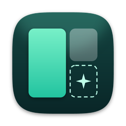
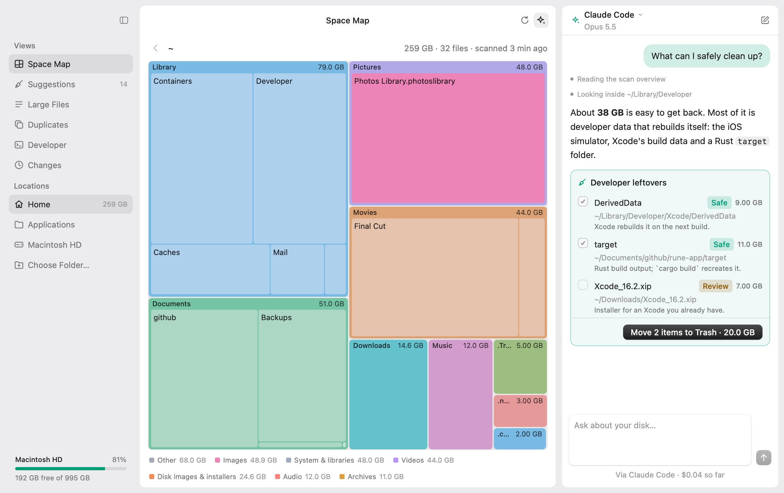
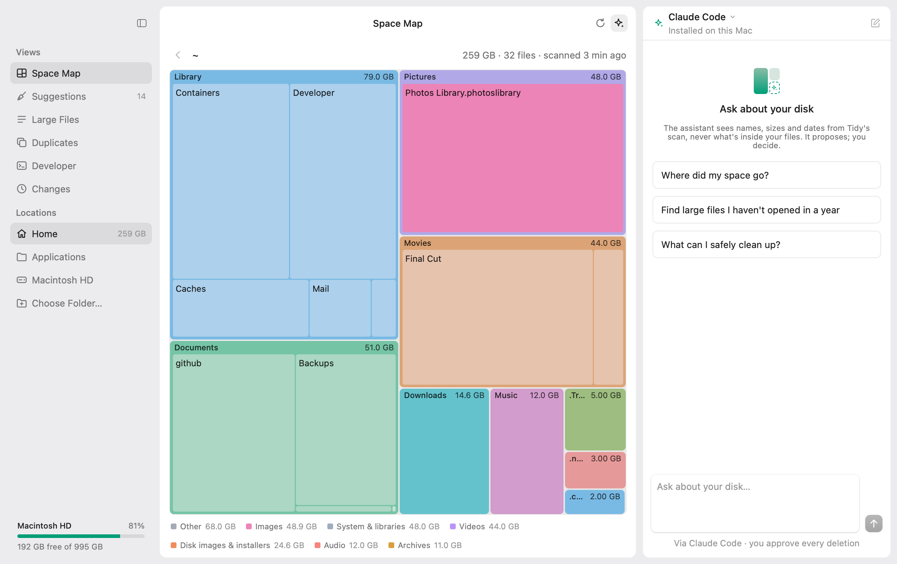
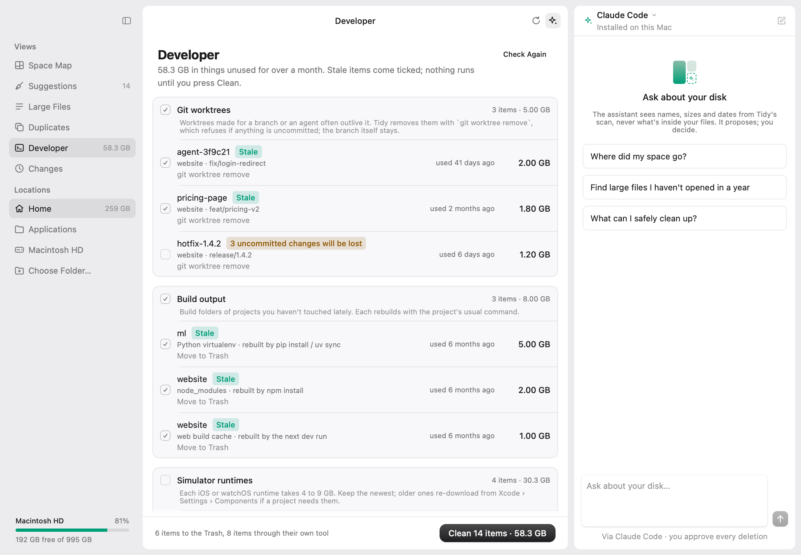
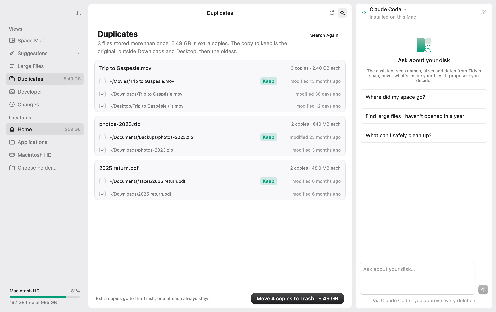
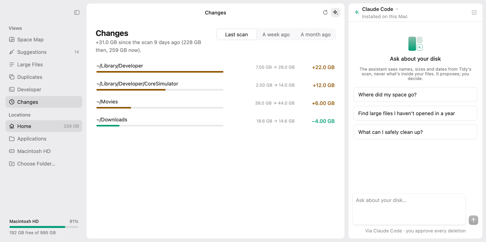
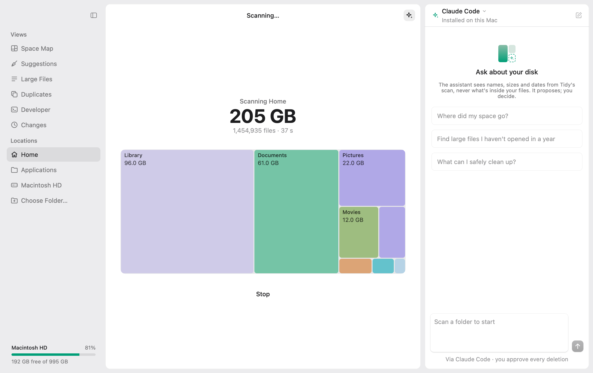
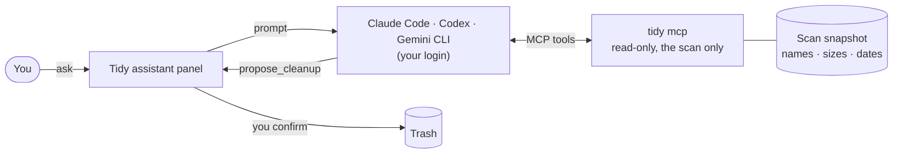
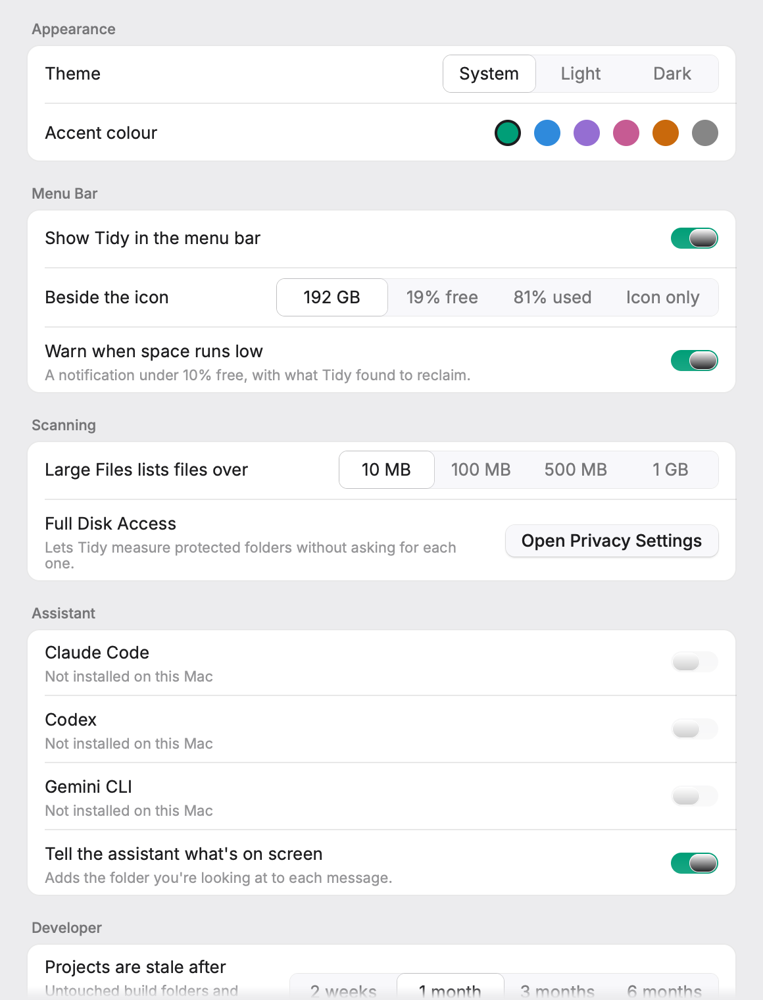

<div align="center">



# Tidy

**See what fills your Mac, and clean it up with the AI you already have.**

A native disk map for macOS, with a developer cleanup view and an assistant that runs on
Claude Code, Codex or Gemini CLI. Built in Rust. Nothing is deleted without you.

[](https://github.com/SebAubin/tidy/actions/workflows/ci.yml)
[](https://github.com/SebAubin/tidy/releases)


[](LICENSE)

[Download](https://github.com/SebAubin/tidy/releases/latest) ·
[Features](#features) ·
[The assistant](#the-assistant) ·
[Privacy](#privacy-and-safety) ·
[Build from source](#build-from-source)

<br>

<picture>
  <source media="(prefers-color-scheme: dark)" srcset="docs/images/assistant-dark.png">
  
</picture>

</div>

## Why Tidy

Disk tools show you a big chart and leave the hard part to you: *is this safe to delete?*
Tidy answers that. It knows which folders rebuild themselves, which worktrees are stale,
which simulator runtimes you never boot, and it lets the AI you already pay for look at the
picture with you, without ever handing it your files.

- **Native and fast.** A GPU-rendered Mac app (Rust on [Rune](https://github.com/anomalyco/rune)),
  SF Pro, the system's menus and dialogs. Four million files scanned in under 30 seconds.
- **Made for developers too.** Git worktrees, Xcode and Android emulators, `node_modules`,
  `target/`, package caches and Docker, each cleaned by the tool that owns it.
- **Your AI, not ours.** Uses the Claude Code, Codex or Gemini CLI already signed in on your
  Mac. No API key to paste, no account to create.
- **Reversible by default.** Everything goes to the Trash, where Finder's *Put Back* works.

## Features

<table>
<tr>
<td width="50%" valign="top">

### Space Map
A squarified treemap of any folder, two levels deep, beside a ranked list. Double-click to
zoom in, <kbd>⎋</kbd> to go back up, right-click for Finder actions. The scan fills the map
in live, and the last map opens instantly on the next launch.

</td>
<td width="50%">

<picture>
  <source media="(prefers-color-scheme: dark)" srcset="docs/images/map-dark.png">
  
</picture>

</td>
</tr>
<tr>
<td width="50%">

<picture>
  <source media="(prefers-color-scheme: dark)" srcset="docs/images/developer-dark.png">
  
</picture>

</td>
<td width="50%" valign="top">

### Developer
Stale **git worktrees** (checked with `git status`, never removed with work in them unless you
say so), unused **iOS simulators and runtimes**, **Android** emulators and orphaned system
images, **build output** of idle projects, **package caches**, extra **toolchains** and
**Docker**. Each with a tip, its last use, and how it's cleaned:
`git worktree remove`, `xcrun simctl delete`, `docker builder prune`… or the Trash.

</td>
</tr>
<tr>
<td width="50%" valign="top">

### Duplicates
Files stored more than once, compared by size, then their first and last 16 KB, then a full
BLAKE3 hash, so most files are never read. App libraries, build output and git checkouts are
left out. The original is kept by default, and Tidy never lets you remove the last copy.

</td>
<td width="50%">

<picture>
  <source media="(prefers-color-scheme: dark)" srcset="docs/images/duplicates-dark.png">
  
</picture>

</td>
</tr>
<tr>
<td width="50%">

<picture>
  <source media="(prefers-color-scheme: dark)" srcset="docs/images/changes-dark.png">
  
</picture>

</td>
<td width="50%" valign="top">

### Changes
Every scan is remembered as a small summary, so Tidy can tell you *where the space went*:
which folders grew or shrank since the last scan, a week or a month ago. It points at the
subfolder responsible, not just its parent.

</td>
</tr>
</table>

**And also:** offline **Suggestions** (caches, old installers, build folders), **Large Files**
with multi-select, a **menu bar** item with free space (or % free / used) and a low-space
notification, a native **Settings** window, the full macOS **menu bar** with Finder's
shortcuts, light and dark themes and six accent colours.

<div align="center">
<picture>
  <source media="(prefers-color-scheme: dark)" srcset="docs/images/scanning-dark.png">
  
</picture>
<br><sub>The map fills in as the scan runs.</sub>
</div>

## The assistant

Tidy doesn't ship an AI. It drives the coding assistant you already use, headless, and gives it
exactly one way to see your disk: Tidy's own **read-only MCP server**.



| Tool | What it gives the assistant |
| --- | --- |
| `overview`, `list_folder`, `find_files` | Sizes, kinds and dates from the scan |
| `developer_findings` | What the Developer view found |
| `show_in_tidy`, `open_view` | Steer the window: zoom the map, open a view |
| `propose_cleanup` | A checklist in the panel. It deletes nothing; you tick and confirm |

Pick the assistant and its model in **Settings › Assistant** (`opus`, `sonnet`… or the CLI's
default), turn any of them off, and Tidy remembers the last one you used.

## Privacy and safety

- **Your files stay on your Mac.** The assistant sees paths, sizes and dates through Tidy's
  tools, never file contents.
- **Only Tidy's tools.** For each conversation, your other MCP servers, plugins (computer use,
  browser…) and shell tools are turned off, without touching your own configuration.
- **Nothing is deleted without you.** The assistant can only propose. Every removal is a
  checklist you confirm, and goes to the Trash unless a developer tool owns the cleanup.
- **One permission, not fifteen.** Tidy asks once for Full Disk Access instead of letting macOS
  prompt for each protected folder, and skips those folders if you'd rather not.

<div align="center">
<picture>
  <source media="(prefers-color-scheme: dark)" srcset="docs/images/settings-dark.png">
  
</picture>
</div>

## Install

1. Download **`Tidy-*-macos-universal.dmg`** from
   [Releases](https://github.com/SebAubin/tidy/releases/latest), open it and drag **Tidy** into
   **Applications**. One download for Apple silicon and Intel.
2. Open Tidy. If the build isn't notarized, macOS blocks it the first time: go to
   **System Settings › Privacy & Security** and click **Open Anyway**.
3. Optional: turn on **Full Disk Access** for Tidy when it asks, so it can measure everything.
4. Optional: sign in once to [Claude Code](https://claude.com/claude-code), Codex or Gemini CLI
   to use the assistant.

Requires macOS 13 or later. A `.zip` of the app and SHA-256 sums are attached to each release
too, and every push to `main` leaves a `.dmg` in the
[CI run's artifacts](https://github.com/SebAubin/tidy/actions/workflows/ci.yml).

## Build from source

```sh
git clone https://github.com/SebAubin/tidy && cd tidy
cargo run -p tidy                        # the app, from a dev build
scripts/bundle-mac.sh --debug --open     # "Tidy Dev.app": keeps its macOS permissions across rebuilds
scripts/bundle-mac.sh --open             # target/Tidy.app, release
scripts/package-mac.sh                   # dist/: universal .dmg (drag to Applications), .zip, SHA-256
cargo test --workspace
```

The toolchain is pinned in `rust-toolchain.toml`. Bundles are signed with your Apple Development
or Developer ID certificate when one is installed, so privacy permissions survive rebuilds.

Every screen renders headless for tests and screenshots, with no window:

```sh
target/debug/tidy --snap map.png --scene map --size 1240x780 --scale 2 --theme dark
# scenes: welcome map suggestions large scanning changes duplicates developer chat
target/debug/tidy --window settings --snap settings.png
```

### Project layout

| Path | What's there |
| --- | --- |
| `crates/tidy-core` | The engine, no UI: parallel scanner, insights, developer findings, duplicates, history, snapshot, MCP server |
| `app` | The Rune app: views, assistant sessions, menu bar item, settings |
| `app/assets/icon` | `make_icon.py` draws the icon and builds `Tidy.icns` |
| `.github/workflows` | CI on every push; a release on every `v*` tag (signed and notarized once the secrets are set) |

## Releases

Push a tag (`git tag v0.2.0 && git push --tags`) and the Release workflow builds a universal
`Tidy.app`, packs it as a `.dmg` with a drag-to-Applications window plus a `.zip`, and publishes a
GitHub release with install notes. Add the secrets listed at the top of
`.github/workflows/release.yml` to have it signed with Developer ID and notarized.

## Roadmap

- Windows (the UI already runs there with Rune; the scanner and cleanup need porting)
- Scheduled cleanup rules ("every Monday, clear DerivedData and merged worktrees")
- External and network volumes, folder comparison
- Sunburst view and search in the scan

## License

[MIT](LICENSE) © 2026 Sebastien Aubin
